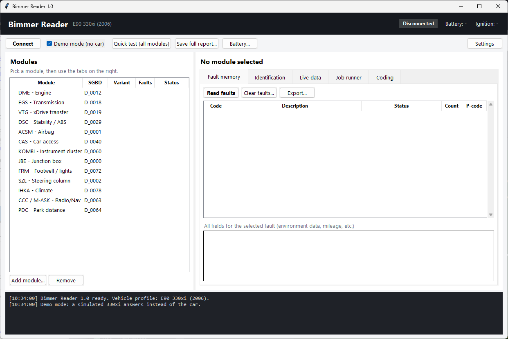
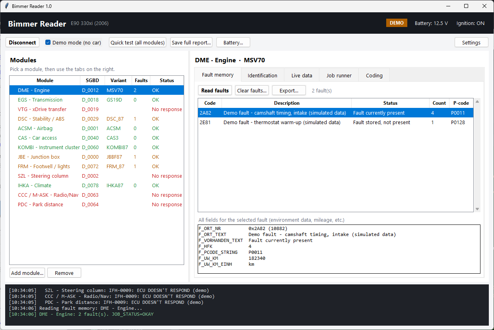
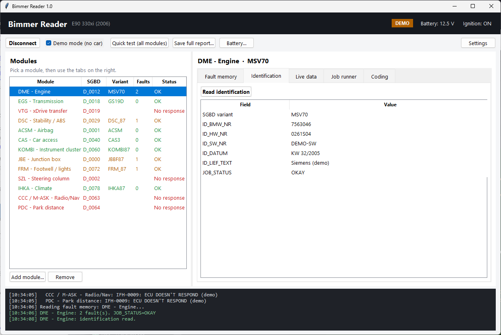
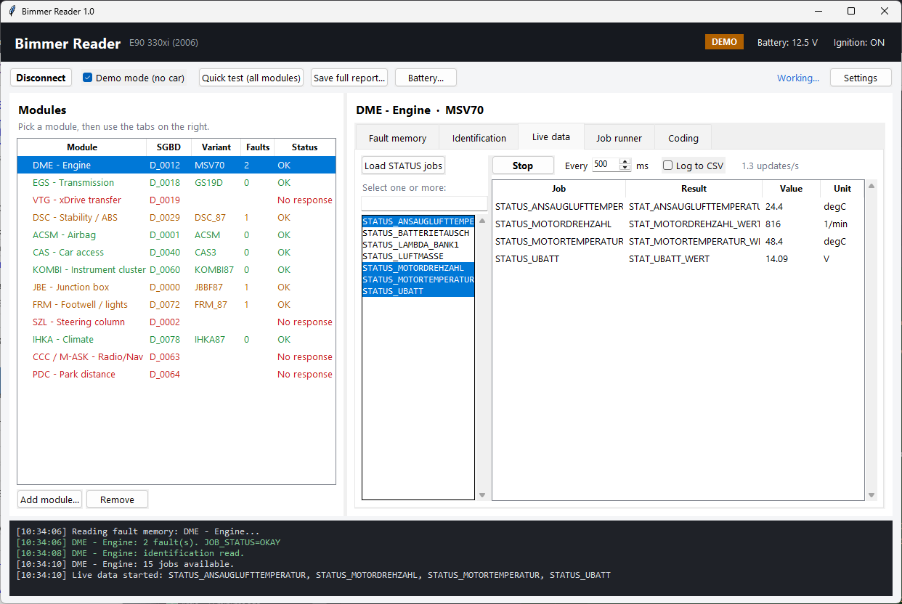
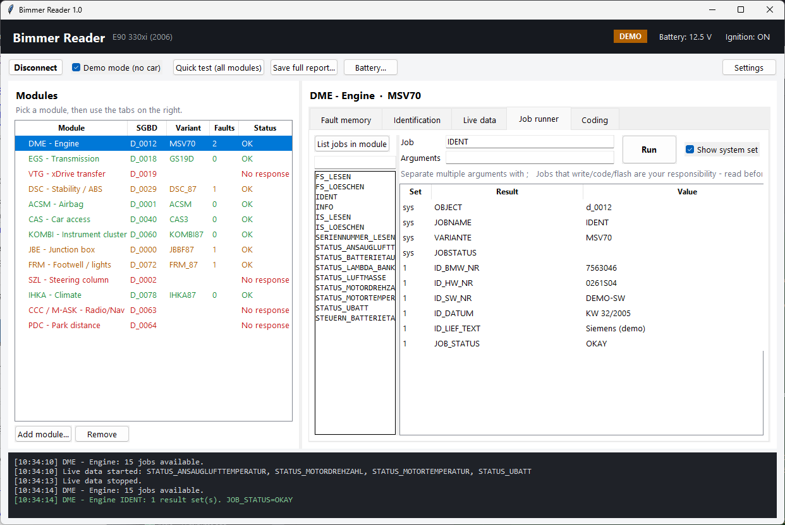
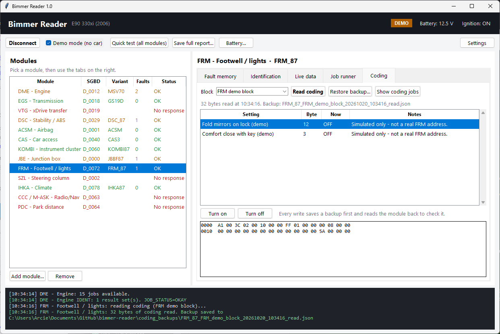
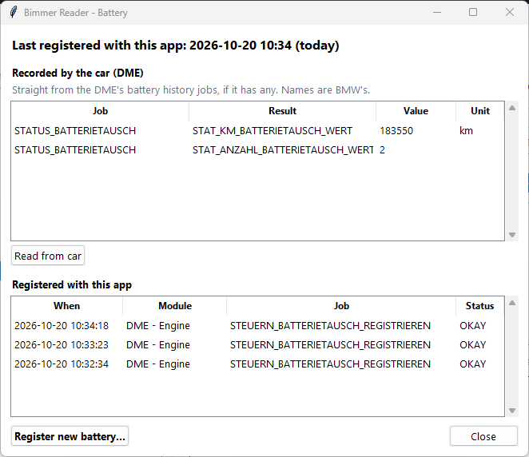

# Bimmer Reader – quick guide

A quick tour of every screen. The screenshots are from **demo mode** (a
simulated 330xi), so the faults and values are made up. For setup, cables and
troubleshooting, see the [README](../README.md).

## 1. Start and connect

1. Start the app with `run.bat`. To practise without the car, tick **Demo
   mode (no car)**.
2. Car: plug the cable into the OBD port, turn the ignition **ON** (engine
   off), then plug the USB into the laptop.
3. Click **Connect**. The header shows **Connected** (or **DEMO**), along
   with battery voltage and ignition. If the battery shows in yellow, it's
   under 12 V. Put a charger on.

The black panel at the bottom is the log. If anything goes wrong, copy it.

## 2. Quick test and fault memory

- **Quick test (all modules)** asks every module for its ID and fault count.
  - **Green:** answered, no faults.
  - **Orange:** answered, faults stored.
  - **Red:** *No response*. Normal for options your car doesn't have.
- Pick a module, then open **Fault memory** and click **Read faults**.
  - Codes still present are shown in red.
  - Click a code to see every field below it, including the mileage when it
    happened (`F_UW_KM`).
- **Clear faults...** asks first, then reads again. A code that comes
  straight back is a live fault.
- Before clearing, use **Export...** (CSV) or **Save full report...** (all
  modules) to keep a record.

## 3. Identification

**Read identification** shows part numbers, hardware/software versions and
dates for the selected module.

## 4. Live data

1. Click **Load STATUS jobs**.
2. Ctrl-click the values you want, then click **Start**. Tick **Log to CSV**
   to record them.
3. Names are BMW's German ones: `MOTORDREHZAHL` = RPM,
   `MOTORTEMPERATUR` = coolant temperature, `UBATT` = battery voltage,
   `ANSAUGLUFTTEMPERATUR` = intake air temperature.

## 5. Job runner

The job runner works like Tool32: **List jobs in module**, pick one, add
arguments (separated by `;`), then **Run**. Tick **Show system set** to see
which file variant answered. It warns you before any job that looks like it
writes, clears, codes or resets something.

## 6. Coding

1. Pick a module, open **Coding**, then click **Read coding**. Every read
   is backed up to `coding_backups/`.
2. Pick a setting, then click **Turn on** or **Turn off**. The app checks
   the battery, saves a backup, writes, then reads back to check the change.
3. If something misbehaves, use **Restore backup...**.

> Only the **demo** settings come with the app. For your real car, each
> module needs a profile in `coding_e90.json` (see the README's Coding
> section). Don't write coding on the car until those values come from a
> coding guide for your exact module.

## 7. Battery

**Battery...** on the toolbar opens the battery window:

- **Recorded by the car:** what the DME itself reports about the last
  battery change, if it keeps that.
- **Registered with this app:** every registration done here, with the date.
- **Register new battery...:** use this after fitting a new battery of the
  **same type and capacity**. A different type or capacity needs coding
  instead.
